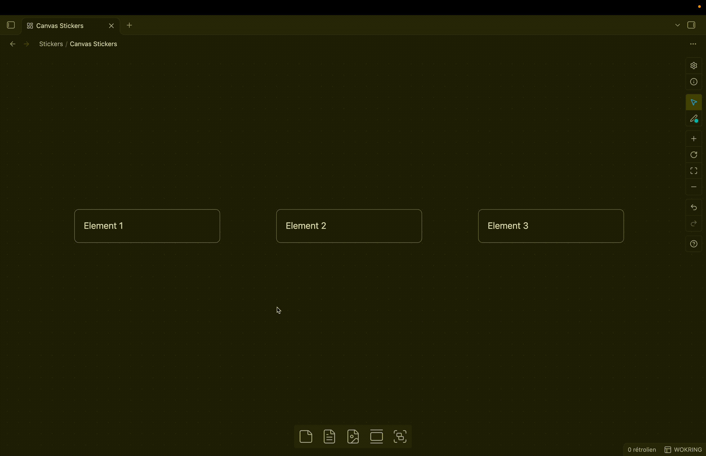
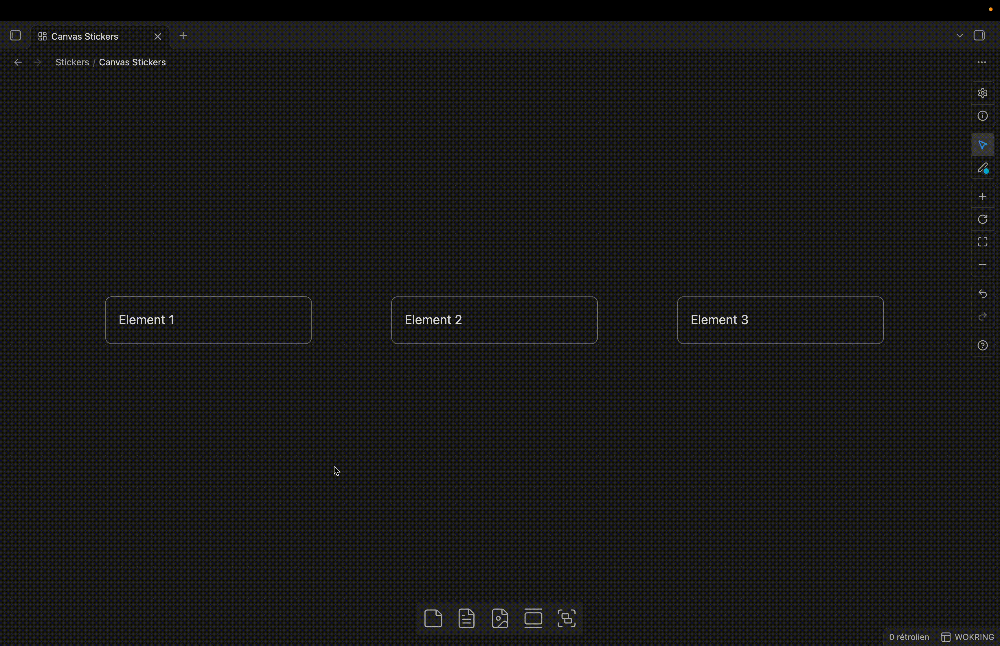

# Canvas Stickers

Add stickers to your canvas view to customize your nodes!

## Why Canvas Stickers

- **Easy adding stickers** • With the stamp, you can easily add your sticker on your canvas with one mouse click.
- **Favorites Stickers Panel** • A Miro/Figma-inspired quick access menu to quickly access to your most used sticker.
- **Full Stickers Panel** • Browse a view where all your stickers are automatically grouped by parent folder.
- **Stickers Custom Nodes** • Canvas nodes specifically customized for stickers to provide the best possible experience.

## How to use

### Sticker Folders

To get started, create a “Stickers” folder at the root of your vault; this folder will hold all your stickers.
Add a subfolder named “Favorites”; this folder will hold your favorite stickers, up to a maximum of 8 stickers.
Folder paths can be customized in the settings.

### Commands/Shortcuts

There are two shortcuts/commands for using Canvas Stickers: 

- **Open Sticker Favorites** - <kbd>Shift</kbd>+<kbd>T</kbd>  • Opens the favorites view

- **Toggle Sticker Palette** - <kbd>Shift</kbd>+<kbd>Cmd/Ctrl</kbd> +<kbd>T</kbd> • Toggles the view showing all stickers.

## Few recommendations for icon libraries

- [**Kenney Emotes Pack**](https://kenney.nl/assets/emotes-pack)
- [**Open Emojis**](https://openmoji.org/)

